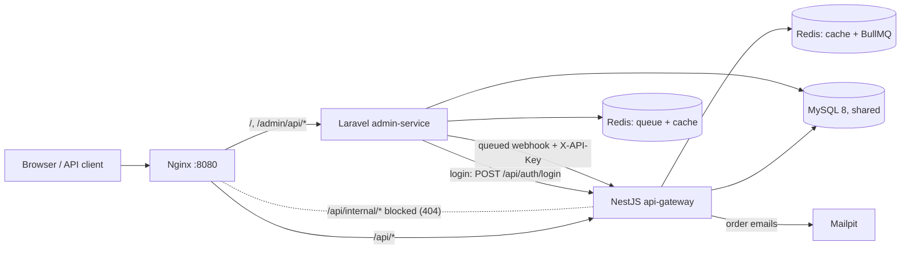

# Hybrid E-commerce Platform

Laravel admin panel (`admin-service/`) and NestJS API gateway (`api-gateway/`) sharing one MySQL database, one JWT, Redis and an Nginx entry point, all started with a single `docker compose up`.



## Contents

- [Setup](#setup)
- [Requirement coverage](#requirement-coverage)
- [API documentation](#api-documentation)
- [Design decisions](#design-decisions)
- [Project structure](#project-structure)

## Setup

**Requirements:** Docker Desktop (or Docker Engine with Compose v2). Nothing else needs to be installed on the host.

```bash
git clone <repo-url> ecommerce-platform
cd ecommerce-platform
cp .env.example .env          # optional: change ports or secrets
docker compose up -d --build
```

The first start takes a few minutes. Compose runs the setup steps in order and only then starts the apps:

1. `admin-assets` builds the Tailwind/Vite assets.
2. `admin-migrate` installs Composer packages if needed, creates `admin-service/.env` and `APP_KEY`, then runs the Laravel migrations.
3. `api-migrate` runs the TypeORM migrations.
4. `seed` loads demo data (it skips itself once data exists, so later `up`s are fast).
5. `admin`, `admin-queue`, `api-gateway` and `nginx` start.

Check progress with `docker compose ps -a`: the four setup services should show `exited (0)`.

| URL | What |
| --- | --- |
| http://localhost:8080 | Admin panel (Laravel) |
| http://localhost:8080/api | Public API (NestJS) |
| http://localhost:8080/api/docs | Swagger UI for the NestJS API |
| http://localhost:8025 | Mailpit inbox (order confirmation emails) |

**Seeded accounts** (password `password` for all):

- `admin@example.com`: admin, can sign in to the admin panel.
- `customer@example.com`: customer, can place orders through the API.
- 10 more random customers; the seed also creates 4 root categories with 9 subcategories, 27 products and 60 orders spread over the last 60 days.

### Running the tests

```bash
docker compose exec api-gateway npm test            # NestJS unit tests (products + orders services)
docker compose exec admin php artisan test          # Laravel feature tests (in-memory SQLite)
```

### Resetting

```bash
docker compose down -v && docker compose up -d      # wipes MySQL/Redis and reseeds
```

### Environment variables

The root `.env` (copied from `.env.example`) feeds `docker-compose.yml`, which passes the values into every container. `admin-service/.env.example` and `api-gateway/.env.example` list each service's variables for running outside Docker.

`JWT_SECRET` and `INTERNAL_API_KEY` must be identical for both services. Compose guarantees this because both read the same variable. `JWT_SECRET` must be at least 32 characters (HS256 key size); the gateway refuses to start otherwise.

## Requirement coverage

| Area | Requirement | Where |
| --- | --- | --- |
| Database | SQL schema with relationships | [`docs/database/schema.sql`](docs/database/schema.sql), ERD in [`DESIGN.md`](docs/database/DESIGN.md) |
| | Migrations for both frameworks | `admin-service/database/migrations`, `api-gateway/src/database/migrations` |
| | Design explanation | [`docs/database/DESIGN.md`](docs/database/DESIGN.md) |
| NestJS core | TypeORM, JWT auth, class-validator, role guards, global errors | `src/database`, `src/auth`, `main.ts` (`ValidationPipe`), `common/guards`, `common/filters/all-exceptions.filter.ts` |
| Products | `GET/POST /api/products`, `GET/PUT /api/products/:id` with DTOs | `src/products` |
| | Redis caching, request logging, service unit tests | `products.service.ts`, `common/middleware/request-logger.middleware.ts`, `products.service.spec.ts` |
| Orders | Validate, check stock, mock payment, queued email, update stock | `src/orders/orders.service.ts`, `payment/`, `mail/` (BullMQ), `orders.service.spec.ts` |
| Admin auth | Breeze, admin middleware, dashboard metrics, user CRUD | Breeze views, `EnsureUserIsAdmin`, `Admin/DashboardController`, `Admin/UserController` |
| Catalogue | Product CRUD with image upload, nested categories, import/export, soft delete + restore | `Admin/ProductController`, `Admin/CategoryController`, `Jobs/ProcessProductImage`, `Jobs/ImportProducts` |
| | Resources, Form Requests, queues, Eloquent relationships | `Http/Resources`, `Http/Requests/Admin`, `Jobs/`, `Models/` |
| Orders & reports | Listing with filters, status management, daily/weekly/monthly reports, CSV/PDF export | `Admin/OrderController`, `Services/OrderStatusService`, `Services/SalesReportService`, `Admin/ReportController` |
| Integration | Laravel creates a product, NestJS syncs via webhook/queue with API key | `Observers/ProductObserver`, `Jobs/SyncProductToGateway`, Nest `src/internal` + `ApiKeyGuard` |
| Shared auth | One JWT for both services, shared session, central user service | NestJS `src/auth` (issuer), Laravel `JwtService`, `JwtSessionMiddleware`, `jwt` guard |
| DevOps | Dockerfiles, Nginx routing, env setup, seeding | `*/Dockerfile`, `docker/nginx/default.conf`, `.env.example` files, `DatabaseSeeder` |

## API documentation

The complete, interactive reference for the NestJS API is Swagger at **http://localhost:8080/api/docs**: every DTO, validation rule and response code is described there and can be tried out after clicking **Authorize** with a token from `/api/auth/login`. A summary follows.

### Authentication

Send the JWT as `Authorization: Bearer <token>`, or rely on the HttpOnly `access_token` cookie that login sets. Both work on both services.

```bash
curl -s -X POST http://localhost:8080/api/auth/login \
  -H 'Content-Type: application/json' \
  -d '{"email":"customer@example.com","password":"password"}'
# {"accessToken":"eyJ...","tokenType":"Bearer","expiresIn":3600,"user":{...}}
```

### NestJS API (`/api`)

| Method | Path | Access | Notes |
| --- | --- | --- | --- |
| POST | `/api/auth/register` | public | `{name, email, password}`; creates a customer and signs them in |
| POST | `/api/auth/login` | public | `{email, password}`; returns the token and sets the cookie |
| POST | `/api/auth/logout` | public | clears the cookie (also ends the admin session) |
| GET | `/api/auth/me` | any signed-in user | current user |
| GET | `/api/products` | public | query: `page`, `limit` (≤100), `categoryId`, `search` (name or SKU), `minPrice`, `maxPrice`, `inStock`, `sort` = `newest` / `price_asc` / `price_desc` / `name` |
| GET | `/api/products/:id` | public | active products only |
| POST | `/api/products` | admin | `{categoryId, sku, name, slug?, description?, price, isActive?, quantity?, lowStockThreshold?}` |
| PUT | `/api/products/:id` | admin | same fields, all optional |
| POST | `/api/orders` | customer | `{items: [{productId, quantity}], paymentToken}`; `paymentToken: "tok_fail"` simulates a declined card |
| GET | `/api/orders` | customer, admin | the caller's orders, paginated (`page`, `limit`) |
| GET | `/api/orders/:id` | customer, admin | customers can only read their own orders |
| POST | `/api/internal/products/sync` | `X-API-Key` | service-to-service only; Nginx returns 404 for it from outside |

Place an order:

```bash
curl -s -X POST http://localhost:8080/api/orders \
  -H "Authorization: Bearer $TOKEN" -H 'Content-Type: application/json' \
  -d '{"items":[{"productId":1,"quantity":2}],"paymentToken":"tok_visa"}'
```

Order responses and status codes:

- `201`: the order is paid and stock is reduced; the confirmation email is queued and shows up in Mailpit.
- `400`: validation failed (unknown or inactive product, bad quantities). Repeated lines for the same product are merged.
- `402`: the payment was declined; nothing is persisted and stock is untouched.
- `409`: not enough stock; the response lists the shortages.

Errors always share the shape `{statusCode, error, message, path, timestamp}`.

### Laravel admin JSON API (`/admin/api`)

Laravel API Resources, available to admins with the same JWT (Bearer header or cookie):

| Method | Path | Query |
| --- | --- | --- |
| GET | `/admin/api/me` | |
| GET | `/admin/api/users` | `search`, `role` |
| GET | `/admin/api/categories` | nested tree |
| GET | `/admin/api/products` | `search`, `category_id`, `status`, `stock` = `low` / `out`, `trashed=only`, `per_page` |
| GET | `/admin/api/products/{id}` | includes trashed products |
| GET | `/admin/api/orders` | `status`, `from`, `to`, `customer`, `min_total`, `max_total` |
| GET | `/admin/api/orders/{id}` | with items |

### Admin panel

Sign in at http://localhost:8080 as `admin@example.com`. The admin panel has these sections:

- **Dashboard:** revenue, order and customer metrics, orders by status, low-stock and top-selling products, recent orders.
- **Products:** filters, image upload (a thumbnail is generated on the queue), trash and restore, CSV export, and CSV import. Import uses the export's columns, upserts by SKU on the queue, and shows a summary with per-line errors.
- **Categories:** nested tree, add a child, circular parents are blocked, trash and restore.
- **Orders:** filters by status, date, customer and total. Status changes follow `pending → paid → processing → shipped → delivered`, and `cancelled` is allowed until shipping. Cancelling returns stock and refunds paid orders.
- **Reports:** daily, weekly or monthly revenue for a date range, exported as CSV or PDF.
- **Users:** CRUD with roles, trash and restore.

## Design decisions

### Shared database, single-owner tables

Both services use one MySQL database, as the brief allows ("shared database with careful transaction management"). To avoid two frameworks fighting over a schema, every table has exactly one owner:

- **Laravel** migrates `categories`, `products` and `inventory`, plus its own framework tables.
- **NestJS** migrates `users`, `orders` and `order_items`.

TypeORM keeps its history in `typeorm_migrations` so it never touches Laravel's `migrations` table. Compose runs Laravel's migrations first because `order_items.product_id` references `products`. Details and the ERD are in [`docs/database/DESIGN.md`](docs/database/DESIGN.md).

### Transactions and stock

Order placement runs in one database transaction:

1. Lock the inventory rows with `SELECT … FOR UPDATE`.
2. Verify stock.
3. Charge the mock payment.
4. Insert the order and its items.
5. Decrement stock.

Two concurrent orders for the last unit can't both succeed, and a declined payment rolls everything back. The email job is queued only after the commit. Admin status changes lock the order row the same way, and cancelling restocks inside the same transaction.

### Product sync: observer → queued webhook → cache refresh

NestJS caches product lists and details in Redis. When an admin changes the catalogue:

1. `ProductObserver` (or `InventoryObserver` for stock changes) dispatches `SyncProductToGateway` after the transaction commits.
2. The Laravel queue worker POSTs `{productId, event}` to `/api/internal/products/sync` with `X-API-Key`.
3. NestJS checks the key in constant time, bumps the cache version (which invalidates every cached list at once) and re-warms that product.

The job is unique per product (bursts collapse into one call) and retries with backoff (5 s → 5 min) if the gateway is down. The cache TTL is the fallback, so a lost webhook can only leave data stale for minutes. The internal route is not exposed through Nginx.

### One JWT, one user service

NestJS is the central user service: it owns `users`, hashes passwords and is the only issuer of tokens. Tokens are HS256 with issuer `ecommerce-platform` and claims `sub`, `email`, `name` and `role`.

- **Admin login:** the Breeze login form calls NestJS `/api/auth/login`, requires the `admin` role, starts a Laravel session and sets the same `access_token` cookie. Laravel excludes that cookie from encryption so NestJS can read it.
- **Shared session:** `JwtSessionMiddleware` keeps both sides in step. An admin who logged in through the API is signed in to the panel automatically, and logging out on either side, or the token expiring, ends the admin session.
- **Admin JSON API:** `/admin/api/*` uses a stateless `jwt` guard, so the same token works with `Authorization: Bearer` as well.
- **No duplicate flows:** public registration and email verification were removed from Breeze. Customers register through the API, and admins are created in user management.
- **Password hashes:** Laravel writes `$2y$` bcrypt hashes and NestJS normalises them to `$2b$`, so users created on either side can sign in.

### Queues

- **NestJS:** the order confirmation email is a BullMQ job (Redis) that sends through SMTP to Mailpit, retried with exponential backoff.
- **Laravel:** image thumbnails, CSV imports and gateway sync run on the Redis queue, served by the `admin-queue` worker. Uploads return immediately; the import summary appears on the products page when the job finishes.

### Caching

Product responses use versioned keys (`products:{version}:…`). Invalidating means incrementing one counter instead of scanning keys, and orders invalidate the cache too because stock changes.

### Validation and errors

- **NestJS:** a global `ValidationPipe` (`whitelist`, `forbidNonWhitelisted`, `transform`) checks every DTO. A global exception filter maps HTTP errors, TypeORM not-found and duplicate-key errors to one JSON shape and logs 5xx errors. A request-logging middleware records the method, path, status, duration and user.
- **Laravel:** Form Requests on every write. Business-rule failures, such as an invalid status transition or deleting a category that still has products, come back as validation errors or flash messages, not 500s.

### Tests

- **NestJS:** unit tests with mocked repositories, cache and queue. They cover the product service (filters, pagination, caching, duplicate SKU and unknown category, transactional create, admin sync) and the order service (paid order with locked stock decrement, insufficient stock, unavailable products, declined payment, email queue failure after commit).
- **Laravel:** feature tests cover the central login, the shared cookie, session sync, profile and password flows. They run on in-memory SQLite and recreate the NestJS-owned tables from a test-only migration.

## Project structure

```
ecommerce-platform/
├── admin-service/            # Laravel 13 (PHP 8.4) admin panel + /admin/api
│   ├── app/Http/Controllers/{Admin,Api,Auth}
│   ├── app/{Jobs,Observers,Services,Models,Http/Requests,Http/Resources}
│   └── database/{migrations,seeders}
├── api-gateway/              # NestJS 11 (Node 22) gateway + core API
│   └── src/{auth,users,products,orders,internal,common,config,database}
├── docker/
│   ├── nginx/default.conf    # routing: /api → NestJS, everything else → Laravel
│   └── mysql/init.sql
├── docs/database/            # schema.sql + DESIGN.md (ERD, ownership, decisions)
├── docker-compose.yml
└── .env.example
```
