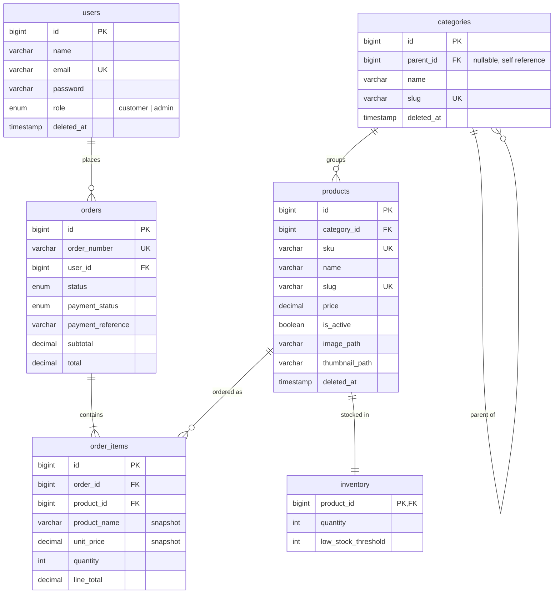

# Database Design

## Overview

One shared MySQL 8 database (`ecommerce`) used by both services. Each table is owned by exactly one framework to prevent migration drift.

| Table        | Owner   | Purpose                                      |
|--------------|---------|----------------------------------------------|
| `users`      | NestJS  | Central user service (customers + admins)    |
| `categories` | Laravel | Admin-managed product catalogue              |
| `products`   | Laravel | Product details and pricing                  |
| `inventory`  | Laravel | Stock levels per product                     |
| `orders`     | NestJS  | Customer order headers                       |
| `order_items`| NestJS  | Line items with price/name snapshots         |

## Entity relationship diagram

## Design Choices

### Separate inventory table

Inventory is kept in its own table rather than a column on `products` because stock changes independently of product metadata. This keeps product updates (name, price, images) separate from quantity adjustments and allows low-stock thresholds without bloating the products table.

### Order item snapshots

`order_items` stores `product_name` and `unit_price` at the time of purchase. If a product is renamed or repriced later, historical orders remain accurate.

### Soft deletes

`users`, `categories`, and `products` use `deleted_at` for soft deletes. This supports the admin trash/restore feature and prevents accidental data loss while keeping referential integrity for existing orders.

### Single-owner tables

Laravel migrations create catalogue tables; NestJS TypeORM migrations create user and order tables. Only one service runs migrations per table, avoiding conflicting schema definitions.

### Indexes

- `orders(status, created_at)` — filters and date-range reports on the order listing.
- `products(category_id, price)` — category and price-range filters on the product catalogue API.

### Cross-service foreign keys

`order_items.product_id` references `products` (Laravel-owned), so the migration sets must run in order. `docker compose up` enforces it with one-shot services chained by `service_completed_successfully`:

1. `admin-migrate`: Laravel catalogue and framework tables (`migrations` history table).
2. `api-migrate`: NestJS user/order tables (`typeorm_migrations` history table, so the two histories never collide).
3. `seed`: Laravel `DatabaseSeeder` fills both services' tables; it skips itself once users exist.
4. `admin`, `admin-queue` and `api-gateway` start only after the seed step succeeds.

The Laravel test suite runs on in-memory SQLite and recreates the NestJS-owned tables from `admin-service/tests/database/migrations`, a test-only mirror of the TypeORM migrations.

### Password hashes

Laravel writes `$2y$` bcrypt hashes; NestJS writes `$2b$`. NestJS normalises the prefix before comparison so both formats work.
